# PDR Spec Casebook

A workspace for turning CyberLink **PowerDirector Mobile** feature specs (PM, Design and MX files, usually huge
Figma-export PDFs) into a plain, reviewed **test-case table**: one row per check, each with an **Action** and an
**Expected Result**, like the SFT/BFT checklists. A person reviews the table in the browser and saves it; the saved
table becomes that feature's **correct answer** for one platform (iOS or Android).

The same workspace then runs the table on the real QA iPhone through Appium, records every case, and drafts and files
eBugs for the failures, always waiting for a person to sign off before anything reaches ECL.

You drive it in plain language through an AI coding agent (Claude Code or Codex). The agent follows the skills in
this repository; the TypeScript scripts in `scripts/` do the mechanical parts (reading the spec, checking the table,
serving the review page, driving the phone, logging results).

It is deliberately simpler than the spec-contract runner: the output is one CSV per feature and platform that a tester
can read without the spec, not contract catalogs and claim files.

---

## Contents

- [How it fits together](#how-it-fits-together)
- [Key concepts](#key-concepts)
- [Rules that apply to every table and run](#rules-that-apply-to-every-table-and-run)
- [Setup](#setup)
- [Using the casebook](#using-the-casebook)
  - [Building or updating a table](#building-or-updating-a-table)
  - [Running a table on the phone](#running-a-table-on-the-phone)
  - [Filing eBugs](#filing-ebugs)
- [Repository layout](#repository-layout)
  - [Inside a feature folder](#inside-a-feature-folder)
- [Features in this repository](#features-in-this-repository)
- [Skills](#skills)
- [Scripts](#scripts)
- [What is not committed](#what-is-not-committed)
- [Contributing](#contributing)
- [Further reading](#further-reading)

---

## How it fits together

```mermaid
flowchart LR
    A[Spec files<br/>PM / Design / MX PDFs] --> B[Fingerprint<br/>new · same · changed]
    B --> C[Read the spec<br/>render + OCR every board]
    C --> D[Coverage passes<br/>+ standing inputs]
    D --> E[Value check]
    E --> F[Draft table<br/>+ requirements + update plan]
    F --> G[Review page<br/>edit · keep · delete]
    G -->|Save| H[Approved table<br/>cases.csv vN]
    H --> I[On-device run<br/>phases · segments · logs]
    I --> J[eBug drafts<br/>+ review page]
    J -. after sign-off .-> K[Filed in ECL<br/>read back]
    I -. gaps and findings .-> D
```



| Stage | What happens | Main output |
| --- | --- | --- |
| **Fingerprint** | The spec files are hashed and compared with the approved table: `NEW`, `SAME` (offer to reuse it) or `CHANGED` (update plan). | JSON on screen |
| **Read the spec** | Each spec set is copied into the feature's library. Every board of the Figma PDF is rendered to tiles and OCR'd (English, Traditional Chinese, Japanese), then read board by board. | `specs/<date>/extracted/` |
| **Coverage passes** | Seven passes find what a board-by-board reading skips: flow arrows, states of every generation job, field rules, numbers, persistence, MX flows and PM-only features. | `requirements.md` sections |
| **Standing inputs** | Re-applied on every draft: the request ledger, open and resolved eBugs, RD build notes on the Testing Request, the template roster and earlier run findings. | `requests.md`, regression rows |
| **Value check** | Merges duplicates, drops checks with no expected result or nothing visible in the app, retires passed one-build checks, parks rows that need an unavailable fixture. | `update-plan.md` → "Not added" |
| **Review** | A local page shows every row with its change against the approved table. You edit, keep or delete rows and save. | `cases.csv`, `history/vN.csv` |
| **Run** | The table runs in phases and segments on the QA iPhone; every case is recorded with evidence, app logs and credit-ledger reads. | `runs/<date>-<phase>/` |
| **eBugs** | Failed cases become eBug drafts, deduplicated against ECL, shown on a review page, and filed only after your sign-off. | `ebugs/<date>/` |

## Key concepts

| Term | Meaning |
| --- | --- |
| **Feature / platform** | A feature ID in kebab-case (`ai-mini-drama`) and a platform (`ios`, `android`). Each pair has its own table, reviewed and approved separately. |
| **Spec set** | The group of spec files received together, stored as `library/<feature>/specs/<date>/` with names, sizes and SHA-256 in `spec-set.json`. The same files again reuse the folder. |
| **Board** | One titled frame group on a Figma-export page (Main flow, Error Handling, each dated update board). Boards are listed in `boards.json` and read one at a time. |
| **Requirement** | One testable statement from the spec, `R-001`, with its source tag (`[PM:<board>]`, `[DS:<board>]`, `[MX:<board>]`, a flow-arrow node, a ledger entry or a build note). |
| **Case (row)** | `TC-001`: Section, Precondition, Action, Expected Result, Priority, Spec Ref, Notes. IDs are never reused or renumbered. |
| **Approved table** | `cases.csv`, the feature's correct answer. Changed only through the review page's Save or an explicit request. Each save is a new version. |
| **Draft** | A proposed change: `draft.csv` with a `Change` column (`new`, `modified`, `removed`, `unchanged`), `requirements.md`, `update-plan.md` and the script that built it. |
| **Request ledger** | `library/<feature>/requests.md`: every request from you, a colleague, a reviewer or RD, numbered `REQ-001`… and re-applied on every draft. |
| **Job-state grid** | A table in `requirements.md` listing, for every generation job, which rows check its start, success, failure, retry, Stop, leave-and-return, wait and done notice. |
| **Phase / segment** | A run is split into phases (P1 core, P23 regression and flows, P4 templates, …) and each phase into segments of 10–40 cases, one clean agent context per segment. |
| **Result / disposition** | Pass, Fail, Blocked, Inconclusive or Not run. Every Fail and Blocked carries a disposition: `defect`, `spec-addition`, `question`, `observability` or `test-data`. |

## Rules that apply to every table and run

The full list is in [`AGENTS.md`](AGENTS.md) (team preferences) and the casebook skill. The ones that shape every
table:

- **Design and PM disagree → the newer one wins.** Dated update boards and frame labels decide. When the dates can't
  tell, the row starts from the Design spec, is marked "check on device", and is decided after the app is checked.
  The MX spec sits between Design and PM.
- **PM-only features are cases.** Anything the PM spec states that the Design spec doesn't draw yet becomes rows now,
  marked "PM-only: no Design frame yet", and is updated when the Design spec draws it.
- **Credit numbers in the spec are binding.** A different price is a Fail, not a mock value.
- **Every request goes in the ledger** the same session it is made, and `check.ts` fails a draft that leaves one
  uncited.
- **The repo stays independent** of the exploration-test folder, the spec agent and other QA tools.
- **Table rows are written in English;** UI strings are quoted exactly as the spec shows them.

And every run on the phone:

- **Appium + XCUITest + WebDriverAgent on the real QA iPhone.** No simulator.
- **No purchases**, sandbox included, unless you approve one for the run. Never type a password.
- **Fault switches** in the Pink debug menu: 「Fail turn」 fails a chat turn; 「Inject failure status」 only affects a
  video beat once filming starts; Trip image moderation fails character and scene images. Bugs found with a switch on
  are re-checked with every switch off.
- **Wi-Fi** may be turned off for offline cases once the phone is confirmed on a USB cable; restore it right after.
- **Nothing is filed in ECL without your sign-off** on the eBug review page, and existing tickets are never commented
  on, reopened or rejected.

## Setup

### 1. Clone

```bash
git clone git@github.com:ethan-hsu-cl/spec-casebook.git
```

On Windows, clone with line-ending conversion off, so the CRLF tables and LF scripts are committed back as they are
(otherwise every `cases.csv` you save shows up as a whole-file change):

```bash
git clone -c core.autocrlf=false git@github.com:ethan-hsu-cl/spec-casebook.git
```

### 2. Install

You need **Node 22.18 or newer** (it runs the TypeScript scripts directly), **Git** and **Python 3** for the eBug
scripts. The full workflow needs **macOS**; Windows covers everything except reading new spec PDFs and iPhone runs:

| Step | macOS | Windows |
| --- | --- | --- |
| Tables: `status`, `fingerprint`, `add-spec`, `new-draft`, `check`, `review`, `export`, `annotations`, `spec-agent-gaps` | ✓ | ✓ |
| Rendering spec frames (`render-region.ts`, `render-tiles.ts`) | ✓ | ✓ |
| Reading a new spec set (`spec-boards.ts`: OCR through Apple's Vision framework and `swift`) | ✓ | ✗ (run it on a Mac and pull the committed `extracted/` text) |
| Run log, log slicing, run plan page (`run-log.ts`, `log-slice.ts`, `plan-page.ts`) | ✓ | ✓ |
| iPhone runs (`device.ts`, `app-setup.ts`: XCUITest, `xcrun`, `ditto`) | ✓ | ✗ |
| Android runs | see [Phone (Android)](#4b-phone-android) | see [Phone (Android)](#4b-phone-android) |
| eBug drafts, format check, filing | ✓ | ✓ |

```bash
npm install
```

If the npm cache errors, add `--cache /tmp/npm-cache` (Windows: `--cache %TEMP%\npm-cache`). PDF rendering uses
MuPDF's WebAssembly build (`mupdf` on npm, AGPL); macOS's own renderer draws these large Figma pages blank.

**Windows notes**

- Install Node from <https://nodejs.org> (LTS, 22.18 or newer), Git for Windows (Claude Code on Windows uses its Git
  Bash) and Python 3 from <https://python.org> or `winget install Python.Python.3.12`.
- Run the commands from the repository root in PowerShell or Git Bash; `node scripts\status.ts` and
  `node scripts/status.ts` both work.
- Python is usually `python` or `py -3`, not `python3`; use that wherever the skills write `python3`.
- `~` in these docs is your user folder (`%USERPROFILE%`, e.g. `C:\Users\<you>`).
- `spec-agent-gaps.ts` reads the spec agent repo from `library/<feature>/spec-agent.json` (`~/Desktop/Spec Agent`);
  clone it to `%USERPROFILE%\Desktop\Spec Agent`, or change the path locally without committing it.

### 3. Check it works

```bash
node scripts/status.ts
```

It lists every approved table and open draft.

### 4. Phone (iPhone, only for on-device runs)

macOS only. A QA build of PowerDirector from TestFlight, the QA iPhone with WebDriverAgent signed and running, and Appium on the
Mac (`appium --relaxed-security`, port 4723). If the phone has never been set up, follow the team's iPhone Appium +
WebDriverAgent setup guide in the exploration-test repository. The scripts reuse a live session and never stop
Appium or WebDriverAgent.

Set these in your shell before the first `device.ts start` of a run (the run folder then remembers the UDID in
`.udid`):

| Variable | What it is | Default |
| --- | --- | --- |
| `PDR_UDID` | Your phone's UDID (`xcrun xctrace list devices`); or pass it to `device.ts start <udid>` | none, required |
| `PDR_WDA_TEAM` | Apple team ID that signs your WebDriverAgent | `LR55RBG94F` |
| `PDR_WDA_BUNDLE` | Bundle ID of your WebDriverAgentRunner | `com.cyberlinkqa1-4.WebDriverAgentRunner` |

The defaults are the team's QA signing account; set the two WDA values only if you signed WebDriverAgent under
another account, or WebDriverAgent will not start.

```bash
export PDR_UDID=<your phone UDID> PDR_WDA_TEAM=<team ID> PDR_WDA_BUNDLE=<bundle ID>
```

### 4b. Phone (Android)

`device.ts` and `app-setup.ts` drive only the iPhone today (Appium's XCUITest driver); there is no Android driver
in the scripts yet, so ask before an Android run which way it should go. Android runs work from macOS or Windows,
and the phone side needs:

- A QA build of PowerDirector on the Android phone, with Developer options › **USB debugging** on and the computer
  allowed when the phone asks.
- **Android SDK Platform-Tools** (`adb`): from Android Studio's SDK Manager, or `winget install Google.PlatformTools`
  (Windows) / `brew install --cask android-platform-tools` (macOS). `adb devices` must list the phone as `device`.
- For Appium-driven runs: **Java 17** (`JAVA_HOME` set), `ANDROID_HOME` pointing at the SDK folder, and Appium with
  the UiAutomator2 driver:

```bash
npm install -g appium
```

```bash
appium driver install uiautomator2
```

```bash
appium --relaxed-security
```

Set an environment variable for the session in PowerShell with `$env:NAME = "value"`, in Git Bash or macOS with
`export NAME=value`.

### 5. ECL (only for eBug filing)

Store your personal ECL API token in `~/.ecl_token` (from <https://ecl.cyberlink.com/sso/mgm/tokenPage>); on Windows
that is `%USERPROFILE%\.ecl_token`. It is used for duplicate searches, IF3 filing and reading tickets back. Keep it
out of the repository.

### 6. Open the folder in your agent

Open this folder in **Claude Code** (skills load from `.claude/skills/`) or **Codex** (`.codex/skills/`). No global
skill copies are needed.

## Using the casebook

Typical requests:

| You want to… | Say something like… |
| --- | --- |
| Make a new table | "Make the iOS test cases for AI Mini Drama from these spec files" (attach the PDFs) |
| Update for a new spec | "Here's the newest PM spec" (attach it) |
| Reuse an approved table | Give the same spec files; the agent tells you the approved version and asks |
| Add a check or rule | "Add a check for …", "From now on …" (it goes in the request ledger) |
| Answer the open questions | "Q-12: use the newer one" — answers become ledger entries and row changes |
| Run the table | "Run the AI Mini Drama table on the phone, phase by phase" |
| Continue a run | "Continue the run" (it resumes from `run-log.ts next` and the last checkpoint) |
| Draft and file eBugs | "Draft the eBugs for P23", then sign off on the review page and "file them" |
| Compare with another tool | "Compare the casebook with the spec agent" |

### Building or updating a table

1. **Fingerprint** the files against the approved table.
2. **Read the spec.** The files are copied into `specs/<date>/`; an overview render is used to list the boards in
   `boards.json`; `spec-boards.ts` renders and OCRs every board. Reading a 230 MB PM file takes about 45–75 minutes,
   so it runs in the background. Design and MX files that didn't change reuse their extracted text.
3. **Write `board-notes.md`** for the spec set, then the requirements: the seven coverage passes, the standing inputs,
   and for an update a board-by-board comparison with the previous set.
4. **Trace and cross-check**: `annotations.ts` lists every annotation block on the boards, and each is traced to the
   requirements that state it; the hidden-clause and variant grids make sure server-side clauses and per-tier rules
   get their own rows. Then `spec-agent-gaps.ts` lists the spec agent cases the table doesn't cover as a backstop:
   one from the spec files becomes a row and names the pass that missed it; every gap goes in the update plan.
5. **Value check**, then the draft (`draft.csv`), usually built by a `build-draft.ts` kept in the draft folder.
6. **`check.ts`** must pass: every row traces to a requirement, every Design flow arrow has a requirement and a row
   that walks it, every open ledger entry is cited, the job-state grid has no empty cell, and every spec agent gap
   is decided and listed in the plan.
7. **Review**: `review.ts` serves `http://127.0.0.1:4387/` (or the next free port). Edit rows, Keep or Delete,
   add cases, then **Save as approved table**. The previous version moves to `history/`.

### Running a table on the phone

- The draft's `phases.json` splits the table into phases and segments, tags cases with what they need (`video`,
  `purchase`, `new-account`, …) and lists the needs this run can't meet; those cases are recorded Blocked up front.
- Each segment runs in a clean agent context; the chat you talk to only orchestrates and never asks between
  segments. A live run plan (`plan-page.ts --serve`, `http://127.0.0.1:4390/`) shows every case, checkpoint, time and
  token use as the run goes.
- Before the first test action: Log stage timings and Write Log on, build and server checked, tier set. When a phase
  needs video, one preview generation runs first as a gate; if it fails, video cases are recorded Blocked instead of
  spending six minutes each.
- After every segment the app logs are pulled and sliced per case (`log-slice.ts`), and every failure's credit charge
  and refund are checked against Credit Details.
- Everything for a run stays in its own folder: `results.csv`, `run-state.md`, `observations.md`, `report.md`,
  screenshots, logs and ledger reads.

### Filing eBugs

Failed cases that share a defect become one draft entry, with numbered one-action Repro steps, a Spec Link to the
Figma node, at least one image and the log excerpt when a log shows the cause. The batch is deduplicated against ECL,
checked by `check_ebug_format.py`, and shown on an HTML review page. Filing waits for your decisions there (severity,
owner, TR, account). After filing, every ticket is read back and recorded in `filed_bugcodes.json`.

## Repository layout

```text
.
├── AGENTS.md                 # Rules for agents, incl. the team preferences (read first)
├── CLAUDE.md                 # Points Claude Code at AGENTS.md
├── INVESTIGATE.md            # Ideas to investigate, not implemented (e.g. several phones at once)
├── .claude/skills/           # Skills for Claude Code
├── .codex/skills/            # The same skills for Codex (kept identical)
├── scripts/                  # TypeScript tools (spec reading, checks, review page, phone, run log)
│   └── lib/                  # Shared helpers (CSV, library paths, spec sets, export)
├── templates/                # Review page template
└── library/
    └── <feature>/            # One folder per feature (see below)
```

### Inside a feature folder

Using `library/ai-mini-drama/` as the example:

| Path | Purpose |
| --- | --- |
| `README.md` | Generated index: approved tables, versions, spec sets received |
| `requests.md` | Request ledger (`REQ-001`…), re-applied on every draft |
| `specs/<date>/` | One spec set: `spec-set.json` (committed), the original files (local only), `extracted/` |
| `specs/<date>/extracted/` | `boards.json`, `boards/<id>.md` (OCR text per board), `board-notes.md`, `arrows.json` (Design flow arrows), comparison notes |
| `ios/cases.csv` | The approved table, the source of truth |
| `ios/cases.xlsx`, `ios/cases.html` | Generated views for reading and sharing |
| `ios/requirements.md` | Requirements with sources, open questions, job-state grid and ledger coverage |
| `ios/manifest.json` | Version, approval time, spec set and checksums, history |
| `ios/history/` | Earlier approved versions (`vN.csv`, `vN-requirements.md`) |
| `ios/drafts/<id>/` | Each draft: `draft.csv`, `requirements.md`, `update-plan.md`, `phases.json`, `build-draft.ts` |
| `ios/runs/` | Run plans and one folder per phase run (`results.csv`, reports, observations, ledger reads) |
| `ios/ebugs/<date>/` | eBug drafts, review page, dedupe and filing records, log excerpts |
| `ios/recipes/` | Saved device command sequences (`*.steps`) reused across runs |
| `ios/comparisons/` | Comparisons with other tools (e.g. the spec agent) |

## Features in this repository

| Feature | Platform | Approved | Cases | Spec set | Runs and eBugs |
| --- | --- | --- | --- | --- | --- |
| `ai-mini-drama` | iOS | v4, 2026-10-22 | 354 | `specs/2026-10-21-2` (PM 10/21, Design and MX 10/19) | Runs 10/16–10/21 on 16.9.0 (189631, 189729); 39 eBugs filed in four batches |
| `ai-mini-drama` | Android | not started | — | — | Android leads are in the request ledger (REQ-022) |

## Skills

| Skill | Use |
| --- | --- |
| `pdr-spec-casebook` | Spec → reviewed table, updates, reuse; coverage passes, standing inputs, value check; on-device runs |
| `ebug-draft-generator` | eBug drafts from failed cases (casebook overlay first) |
| `ebug-tr-filer` | Dedupe, format check, review page, filing through the IF3 API, read-back (needs `~/.ecl_token`) |

Each skill exists for Claude Code (`.claude/skills/`) and Codex (`.codex/skills/`); keep both copies identical.

## Scripts

All scripts run from the repository root with `node scripts/<name>.ts`.

| Script | What it does |
| --- | --- |
| `status.ts` | Lists every approved table and open draft |
| `fingerprint.ts <feature> <platform> <files…>` | Compares spec files with the approved table: NEW, SAME or CHANGED |
| `add-spec.ts <feature> <files…>` | Copies a spec set into `library/<feature>/specs/<date>/` |
| `new-draft.ts <feature> <platform> --title "<Name>" <files…>` | Starts a draft and records its spec set |
| `render-region.ts <pdf> <out.png> [x y w h]` | Renders part of a huge Figma page to look at a frame |
| `render-tiles.ts <pdf> <out dir> [x y w h]` | Renders a region as a grid of readable tiles |
| `spec-boards.ts <feature> <spec-set> [--file] [--jobs 3]` | Renders and OCRs every board in `boards.json` (uses `ocr-tiles.swift`) |
| `annotations.ts <feature> <platform> --draft <id>` | Groups every board's annotations into blocks to trace to requirements (`annotation-trace.json`) |
| `spec-agent-gaps.ts <feature> <platform> --draft <id>` | Lists spec agent cases the table doesn't cover, with their source (reads the spec agent with git only) |
| `check.ts <feature> <platform> [--draft <id>]` | Validates a table or draft, incl. arrows, ledger, grids and spec agent gaps |
| `review.ts <feature> <platform> [--draft <id>]` | Serves the review page and saves the approved table |
| `export.ts <feature> <platform>` | Rebuilds `cases.xlsx` / `cases.html` from `cases.csv` |
| `device.ts <run dir> <command>` | Appium client for the QA iPhone: screenshots, taps, `scrollto`, `waitfor`, `pink`, recipes, logs, ledger |
| `app-setup.ts <run dir> <command>` | Build check, reinstall from TestFlight, first launch, Developer Server, fresh install, log pulls |
| `run-log.ts <run dir> <command>` | Records results and dispositions, phases, gate, retest queue, checkpoints, time summary |
| `log-slice.ts <run dir> <pull dir>` | Cuts a log pull into per-case excerpts (failures, toasts, charges, stage timings) |
| `plan-page.ts <feature> <platform> <draft> <plan.md>` | Builds or serves the live run plan |
| `token-usage.ts`, `usage-log.ts` | Claude token use and plan-usage snapshots for run reports |
| `ebug-defaults.ts <feature> <platform>` | Filing defaults (creator, TR, source tag) from the newest filed batch |

`npm run <name>` shortcuts exist for the common ones (`status`, `check`, `review`, `export`, `fingerprint`,
`add-spec`, `new-draft`, `spec-boards`, `render-tiles`, `render-region`, `ebug-defaults`).

## What is not committed

`.gitignore` keeps these on the machine that produced them:

- **Spec originals** (the large PDFs) and rendered board tiles. Each spec set's `spec-set.json` (names, sizes,
  SHA-256), the extracted text and the notes are committed.
- **All images and videos**: run screenshots (with the on-screen text dumps saved next to them), eBug attachments and
  renders. Results, reports and eBug drafts keep the file names that point at them. The eBug review pages are
  committed with their images embedded.
- **Pulled app logs, Appium session files and full eBug logs** (they can hold tokens). The checked log excerpts
  attached to eBugs are committed.
- `node_modules/`, Python caches and patch leftovers.

## Contributing

- Write new scripts in TypeScript (`node` runs them directly).
- Change a skill in both `.claude/skills/` and `.codex/skills/` and keep them identical.
- Add standing preferences to [`AGENTS.md`](AGENTS.md) › Team preferences (dated) and feature requests to the
  feature's `requests.md`, not to a personal agent memory.
- Never edit an approved `cases.csv` by hand without a request; go through a draft and the review page.
- Keep spec files only under `library/<feature>/specs/`.
- Before committing, check staged files for credentials and images.

## Further reading

- [`AGENTS.md`](AGENTS.md): repository rules and team preferences
- [`.claude/skills/pdr-spec-casebook/SKILL.md`](.claude/skills/pdr-spec-casebook/SKILL.md): the full workflow, coverage
  passes, run rules and file formats
- [`library/ai-mini-drama/requests.md`](library/ai-mini-drama/requests.md): an example request ledger
- [`library/ai-mini-drama/ios/runs/RUN-PLAN-20261019.md`](library/ai-mini-drama/ios/runs/RUN-PLAN-20261019.md): an example phased run plan
- [`INVESTIGATE.md`](INVESTIGATE.md): ideas not yet implemented
